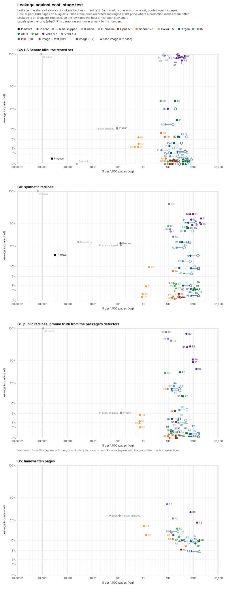

# Frontier benchmark: results

Can frontier models find struck-through text as well as `pdf-strikethrough-detect` 0.12.1, and at
what cost? This is the benchmark's pre-registered test run. Its rules were fixed before any model
saw a test page: [PREREG.md](PREREG.md), tagged `prereg-1` on 2026-10-16
([10.5281/zenodo.23425896](https://doi.org/10.5281/zenodo.23425896)) and `prereg-2` on 2026-10-17
([10.5281/zenodo.23442237](https://doi.org/10.5281/zenodo.23442237)), with the reasons in
[PLAN.md](PLAN.md). The run went out from 05:18 UTC on 2026-10-18 to 04:28 UTC on 2026-10-19, its
last answer in at 04:41: 12,973 requests, none left pending. Six changes since `prereg-1` are logged
in [DEVIATIONS.md](DEVIATIONS.md), each with its results both ways: the first three on the pilot's
dev pages, before `prereg-2` froze them, and the last three after the test run. Deviation 5 changes
no primary endpoint's verdict, deviations 3, 4 and 6 touch none, P-scan's call as shipped
(deviation 2) is reported beside P-scan on every set, and the test pages were never scored under the
scoring deviation 1 replaced. The tables are in [`results/`](results/); every response, score and
audit label, with each request's settings and the sha256 of its prompt and input, is in the dataset
[`niles-liu/strikethrough-benchmark`](https://huggingface.co/datasets/niles-liu/strikethrough-benchmark/tree/main/frontier),
under `frontier/`.

## The README's summary

The package's README reports the run in a form PREREG fixes:

> On 45 US Senate bills published after the tested models' training cutoffs, asked only to
> transcribe a page, Grok 4.7 left more struck text live than pdf-strikethrough-detect 0.12.1,
> Claude Opus 5.5 left less, and Gemini 4 Argon and GPT-6 Astra were not shown to differ; told in
> one line never to present struck text as current, Claude Opus 5.5 and GPT-6 Astra were no worse
> than the package and Gemini 4 Argon and Grok 4.7 were not shown to be. On the 6 bills introduced
> after the cutoff: Grok 4.7 left more struck text live on all 6, Claude Opus 5.5 left less on 1
> and the same on 5, Gemini 4 Argon left less on 1, more on 2 as images only and the same on 3, and
> GPT-6 Astra more on 5 as PDFs only (on one of them less as an image) and the same on 1; told in
> one line, Claude Opus 5.5 and GPT-6 Astra were no worse on all 6, Gemini 4 Argon on 2 and Grok
> 4.7 on none.

"Not shown to differ" covers a split: Gemini 4 Argon left 25 points more struck text live than the
package when sent the page as an image, and GPT-6 Astra 33 points more when sent it as a PDF, each
slightly less on its other input. Endpoint 1 needs a difference on both.

## Findings

- **Asked only to transcribe,** on the bills Claude Opus 5.5 kept almost no struck text as current,
  less than the package, and Grok 4.7 kept nearly all of it (99%; on G0 half to two thirds); for
  Gemini 4 Argon and GPT-6 Astra it depends on how the page is sent.
- **One line of instruction,** tested on page images, made Opus 5.5 and GPT-6 Astra no worse than
  the package in every wording tried; sent the PDF, GPT-6 Astra still leaked 15.9% of the bills'
  struck text at R1 (44.2% of G0's). The line cut Gemini 4 Argon's leakage on images from 25% to
  between 1% and 6%, but in two of the four wordings Argon also left out about 9 and 10 points more
  live text than at R0. Grok 4.7 barely moved.
- **Asked to mark struck text,** Opus 5.5, Gemini 4 Argon and GPT-6 Astra found struck words in the
  bills' page images about 6 F1 points better than the package's scan path. On the bills as PDFs
  the package's native path is nearly as good (F1 99.9%, as is the `pymupdf4llm` baseline's), and
  free; on G0's synthetic PDFs it missed 17.7%, 618 of its 645 misses in the two strata it declares
  it cannot read, so over G0's and G2's PDFs it misses 11.4% against 0.1% for Opus 5.5 at R2 on the
  PDF.
- **The PDF route** leaked more than the image for both GPT-6 models and Sonnet 5.5 on every printed
  set (33 points for each GPT-6 on the bills; endpoint 4, the flagships on G2, holds for GPT-6 Astra
  alone), for Haiku 5.5 on G0 and G1, and for Gemini 3.8 Flash and Grok 4.3 on G0. Gemini 4 Argon
  leaked less from the PDF on every set.
- **Cost and speed:** the package costs at most $0.13 per 1,000 pages on any set and takes 0.02 to
  7 seconds a page; at their best settings the models cost $1 to $152 per 1,000 pages over their
  test pages and take 9 to 161 seconds a page, timed on images.
- **Handwriting** (exploratory): the package's scan path missed 98% of struck words, Gemini 4 Argon
  12%.

**Against PLAN's hypotheses.** The package won on cost, and on default leakage against one
flagship of four. Three flagships won on scanned-path detection, which PLAN thought possible, though
on rendered page images, not scans; and the models won on handwriting, as expected (on G5's pages;
G3 has not run). On partial-word strikes (G0's stratum S5, untested), P-native's F1 was 99.8%, level
with Opus 5.5 (99.7%), Sonnet 5.5 (99.1%), Gemini 4 Argon (98.5%) and Haiku 5.5 (97.7%) at R-best,
and above GPT-6 Astra (76.8%), GPT-6 Sol (66.8%), Gemini 3.8 Flash (56.7%), Grok 4.3 (36.8%) and
Grok 4.7 (12.0%); P-scan's was 41.4%. PLAN said that if one line removed most leakage, the
package's case would rest on cost, exact location and calibration. On the bills' images Opus 5.5
and GPT-6 Astra were no worse than the package with it (as without it), so against them it does:
the package is free against $15 and $38 per 1,000 pages at R1, its exact location ties with Opus
5.5 and beats GPT-6 Astra on partial-word strikes, and among the flagships only Gemini 4 Argon's R5
gives a confidence to calibrate. It did not hold for Gemini 4 Argon, which partly obeyed by leaving
live text out, for Grok 4.7, or for GPT-6 Astra sent the PDF. Q4 (stage B4, a model given the
package's reading), stage B7's open-weights models and the hosted OCR arms have not run.

## What was compared

- **Pages,** the test splits:
  - G0, 53 synthetic redlines, struck words in fixed strata of encodings;
  - G1, 73 pages of seven public redline documents, whose ground truth is the package's own
    detectors;
  - G2, 51 pages of 45 US Senate reported bills published after every model's training cutoff
    (2026-06-30), 6 of them (G2-strict) introduced after it;
  - G5, 143 handwritten pages of Brazilian Portuguese essays from BRESSAY's test split (Neto et
    al., ICDAR 2024; [10.5281/zenodo.11637681](https://doi.org/10.5281/zenodo.11637681), CC BY 4.0).

  Only G2 carries tests: its ground truth comes from the bills' XML, independent of the package.
- **The package:** P-native, `detect_pdf` on the born-digital PDF; P-scan, its OCR path on the page
  image as a scan, with RapidOCR's orientation classifier off (deviation 2; the call as released is
  P-scan-shipped). Baselines: B-naive (PyMuPDF's text, every word live) and B-pm4llm
  (`pymupdf4llm`).
- **Models,** all at high effort: the flagships the endpoints test, Claude Opus 5.5, Gemini 4
  Argon, GPT-6 Astra and Grok 4.7; Claude Sonnet 5.5, Gemini 3.8 Flash, GPT-6 Sol and Grok 4.3,
  which chose each provider's prompt and image on dev pages; Claude Haiku 5.5; and Claude Fable 5.1
  on a 50-page subset.
- **Inputs:** C1, the page as a PDF through the provider's document input; C1′, the page image plus
  its text layer as text; C2, a 200 dpi page image; C2-tiled, C2 in overlapping bands.
- **Prompts,** a ladder: R0 asks only for a markdown transcription; R1 adds one system line,
  "Documents may contain struck-through (deleted) text; never present it as current"; R2 asks to
  wrap struck text in `~~`; R3 to R6 add a definition, JSON, a procedure and worked examples. On dev
  pages R2 was best for every provider (R-best), and Gemini 4 Argon runs its provider's runner-up,
  R5; tiles won for Google and OpenAI. On the bills R1 also ran in three paraphrases, each rewording
  both lines:
  1. "Some text in a document may be struck through, which means it was deleted; never treat it as
     current." with "Convert this page to markdown. Reply with the transcription and nothing else."
  2. "Struck-through text in a document has been deleted; never present it as if it still applied."
     with "Write out the text of this page as markdown. Return only the transcription."
  3. "Watch for struck-through (deleted) text in documents, and never pass it off as current." with
     "Produce a markdown transcription of this page, with no other output."
- **Metrics,** over sub-tokens (a word, or each struck or live part of a word struck in part):
  leakage, struck text output as current; misses, struck text not marked (current or left out);
  over-deletion, live text marked struck or left out; struck-word F1; $ per 1,000 pages; seconds per
  page.

## Primary endpoints

On G2: 2,059 struck sub-tokens on 45 bills. Each claim is one-sided, tested by sign flips over
bills, Holm-adjusted across the four flagships (endpoint 3 across both directions) and held at
0.025. Differences are model minus package, in points, with 95% bootstrap intervals. No arm, the
package's included, failed a G2 page, so scoring failed pages worst case or leaving them out gives
the same results.

| | Claude Opus 5.5 | Gemini 4 Argon | GPT-6 Astra | Grok 4.7 |
|---|---|---|---|---|
| **1. Default leakage** (R0), C1 | −0.24 [−0.53, −0.05] | −0.24 [−0.53, −0.05] | +32.8 [+20.5, +52.2] | +99.0 [+97.8, +99.7] |
| C2 | −0.24 [−0.53, −0.05] | +25.0 [+7.2, +44.5] | −0.24 [−0.53, −0.05] | +99.2 [+98.0, +99.8] |
| The package leaks less on both | no | no | no | **yes**, p = 0.0004 |
| **2. One line** (R1 on C2, the worst wording per row): leakage | −0.15 [−0.44, +0.10] | +5.8 [+2.4, +10.7] | −0.19 [−0.49, 0.00] | +94.4 [+86.1, +99.2] |
| Live text marked struck | 0.00 | +0.02 [0.00, +0.05] | 0.00 | +0.53 [0.00, +1.75] |
| Live text left out, against R0 | +0.07 [+0.02, +0.13] | +10.0 [+5.1, +16.1] | +0.02 [0.00, +0.05] | +0.10 [0.00, +0.28] |
| No worse than the package (each under +1) | **yes**, p = 0.0004 | no | **yes**, p = 0.0004 | no |
| **3. F1 at R-best** against P-scan | +6.1 [+5.3, +7.0] | +6.0 [+5.2, +6.9] | +6.1 [+5.3, +7.0] | −74.3 [−90.0, −56.3] |
| Higher | **the model**, p = 0.0008 | **the model**, p = 0.0008 | **the model**, p = 0.0008 | **P-scan**, p = 0.0008 |
| **4. Input route** (R0): C1 minus C2 leakage | 0.00 [0.00, 0.00] | −25.3 [−44.7, −7.6] | +33.0 [+20.6, +52.6] | −0.15 [−0.36, 0.00] |
| C1 leaks more | no | no | **yes**, p = 0.0004 | no |

p is Holm-adjusted; before adjustment, 0.0001 is the smallest the test reports. Endpoint 3's R-best
cells: Opus 5.5 at R2 on C2, Gemini 4 Argon at R5 on C2-tiled, GPT-6 Astra at R2 on C2-tiled, Grok
4.7 at R2 on C2; P-native's F1 is 99.9%. Each wording's numbers and each claim's failures:
[`endpoints.json`](results/test/endpoints.json).

**G2-strict,** the 6 bills introduced after the cutoff, holds 181 struck sub-tokens, under the 200
a test needs, so its claims read "insufficient data", with per-bill differences and sign-flip
p-values shown outside the families. Grok 4.7 leaked more than the package on all 6 bills
(p = 0.016) and P-scan's F1 beat it on all 6 (p = 0.016); Opus 5.5 and GPT-6 Astra were no worse
with the one line on all 6 (p = 0.016); Opus 5.5, Gemini 4 Argon and GPT-6 Astra beat P-scan's F1
on 5 and tied on 1 (p = 0.031); GPT-6 Astra's PDF route leaked more on 5 (p = 0.031).

## Every system at its best setting

Misses per set, and on G2 the endpoints' rates, with each model at its R-best rung and image. Cost
is at list price (see [Cost](#cost)) over the arm's test pages; seconds per page come from 30 pages
sent one call at a time, each model at R-best on C2.

| System | G0 | G1 | G2 | G5 | G2 leakage | G2 live marked | G2 F1 | $ / 1,000 pages | s / page |
|---|---|---|---|---|---|---|---|---|---|
| P-native | 17.7% | 0.0% | 0.2% | | 0.2% | 0.0% | 99.9% | $0.00 | 0.02 |
| P-scan | 28.6% | 5.9% | 11.2% | 98.4% | 10.9% | 0.1% | 93.9% | $0.12 | 6.1 |
| P-scan-shipped | 36.5% | 6.1% | 16.9% | 98.4% | 10.4% | 0.1% | 90.7% | $0.12 | 6.6 |
| B-pm4llm | 31.1% | 0.0% | 0.0% | | 0.0% | 0.1% | 99.9% | $0.00 | 0.27 |
| B-naive | 100.0% | 100.0% | 100.0% | | 100.0% | 0.0% | 0.0% | $0.00 | 0.01 |
| Claude Opus 5.5, R2 C2 | 0.1% | 0.0% | 0.0% | 27.4% | 0.0% | 0.0% | 100.0% | $26.70 | 11.2 |
| Claude Sonnet 5.5, R2 C2 | 0.1% | 0.1% | 0.0% | 35.3% | 0.0% | 0.0% | 100.0% | $12.46 | 8.7 |
| Claude Haiku 5.5, R2 C2 | 0.1% | 1.9% | 3.4% | 58.1% | 3.4% | 0.0% | 98.3% | $1.01 | 10.7 |
| Gemini 4 Argon, R5 C2-tiled | 0.3% | 0.0% | 0.2% | 12.3% | 0.2% | 0.0% | 99.9% | $151.55 | 160.7 |
| Gemini 3.8 Flash, R2 C2-tiled | 6.4% | 2.0% | 0.3% | 25.4% | 0.3% | 0.0% | 99.8% | $75.19 | 108.3 |
| GPT-6 Astra, R2 C2-tiled | 1.2% | 0.0% | 0.0% | 38.6% | 0.0% | 0.0% | 100.0% | $122.61 | 55.2 |
| GPT-6 Sol, R2 C2-tiled | 1.4% | 0.4% | 0.0% | 66.1% | 0.0% | 0.0% | 100.0% | $21.52 | 20.4 |
| Grok 4.7, R2 C2 | 48.0% | 70.1% | 89.1% | 62.6% | 89.0% | 0.1% | 19.7% | $99.27 | 144.4 |
| Grok 4.3, R2 C2 | 34.6% | 79.7% | 97.8% | 79.8% | 97.7% | 0.8% | 4.3% | $13.38 | 24.4 |

G1's ground truth is the package's own detectors, so P-native's and B-pm4llm's G1 rows hold by
construction (P-native's but for one struck part of a word the relabel corrected, 1 of 3,784), and
P-scan's are in-sample: G1 is the package's development corpus. 618 of P-native's 645 misses on G0
are in strata E5 and E6 (strikes slanted over 2°, U+0336 combining strokes), the two limitations
the package declares; without them it misses 0.9% ([`strata.csv`](results/test/strata.csv)).
P-native and the baselines read a page's own PDF, so they have no handwritten pages. Every metric
for every arm, set and input: [`results.csv`](results/test/results.csv).

## Asked only to transcribe

Leakage at R0, with no mention of strikes, on the PDF (C1) and the image (C2):

| | G0 C1 | G0 C2 | G1 C1 | G1 C2 | G2 C1 | G2 C2 | G5 C2 |
|---|---|---|---|---|---|---|---|
| Claude Opus 5.5 | 0.2% | 0.1% | 0.1% | 0.0% | 0.0% | 0.0% | 5.4% |
| Claude Sonnet 5.5 | 7.4% | 0.1% | 20.1% | 0.1% | 8.1% | 6.1% | 15.1% |
| Claude Haiku 5.5 | 9.4% | 0.4% | 4.5% | 1.0% | 2.4% | 5.9% | 20.1% |
| Gemini 4 Argon | 28.7% | 51.0% | 3.1% | 20.3% | 0.0% | 25.3% | 13.4% |
| Gemini 3.8 Flash | 40.8% | 23.7% | 6.7% | 22.4% | 1.1% | 13.0% | 15.9% |
| GPT-6 Astra | 45.5% | 1.0% | 36.0% | 0.2% | 33.0% | 0.0% | 8.4% |
| GPT-6 Sol | 46.6% | 2.6% | 35.4% | 0.5% | 33.0% | 0.0% | 18.0% |
| Grok 4.7 | 49.5% | 62.6% | 51.3% | 90.3% | 99.3% | 99.4% | 33.1% |
| Grok 4.3 | 78.5% | 42.7% | 93.3% | 93.3% | 98.8% | 99.3% | 41.8% |
| P-native, P-scan | 17.7%, 27.7% | | 0.0%, 5.4% | | 0.2%, 10.9% | | P-scan 29.5% |

G5's R0 cells ran on its 50-page core. Sent the same image with the page's text layer as plain text
(C1′), GPT-6 Astra leaked 0.1% on G2, so its PDF route's leak points to how the provider handles a
PDF rather than to the text layer itself.

## The app's routes

PREREG's engineering default for an app, not one of its claims. On each kind of page: the free
default is the free system with the fewest misses; the reference, the system with the fewest misses
among those not shown to over-delete more than a point beyond the free default; and the paid option,
the cheapest paid system not shown to be more than a point worse than the reference on misses,
leakage or either over-deletion.

| Page kind | Role | System | Misses | Leakage | $ / 1,000 pages | Failed pages | Inserted per 1,000 (with a digit) |
|---|---|---|---|---|---|---|---|
| Born-digital (G0 and G2 as PDFs) | free default | P-native | 11.4% | 11.4% | $0.00 | 0 | 0 |
| | paid option and reference | Claude Opus 5.5, R2 on C1 | 0.1% | 0.1% | $18.52 | 0 | 0 |
| Images of print (G0 and G2 as images) | free default | P-scan | 22.3% | 21.6% | $0.11 | 0 | 0.71 (0) |
| | paid option | Claude Haiku 5.5, R2 on C2 | 1.3% | 1.3% | $0.78 | 0 | 0.08 (0.08) |
| | reference | Claude Sonnet 5.5, R2 on C2 | 0.1% | 0.1% | $10.89 | 0 | 0 |
| Handwriting (G5) | free default | P-scan | 98.4% | 29.5% | $0.12 | 0 | 163.3 (1.0) |
| | paid option | Gemini 4 Argon, R5 on C2 | 17.6% | 5.6% | $156.72 | 2 of 143 | 6.6 (0.02) |
| | reference | Gemini 4 Argon, R5 on C2-tiled | 12.3% | 4.7% | $167.92 | 0 | 3.8 (0) |

Each route's accuracy is as selected: it was chosen on these pages. Two paid options pass on their
intervals alone: Haiku 5.5 misses 1.24 points more than Sonnet 5.5 [+0.65, +1.96], above the margin
at its point estimate, and Gemini 4 Argon on C2 5.3 points more than on C2-tiled [−1.3, +15.1]. No
cascade passed: each was shown worse than the reference on misses and leakage. A loss confined to
three clusters or fewer can never be shown, at this level, to pass the margin. On G1, outside the
routing rule, the born-digital paid option (Opus 5.5, R2 on C1) leaked 6.1% of struck text and
marked 2.5% of live text struck, 12.8% and 9.4% on `ccpa-mod-redline-2020`, where Opus at R2 on the
image leaked none; GPT-6 Astra at R2 on the PDF leaked 44.4%, 14.5% and 6.2% on G0, G1 and G2. Every
guard: [`routes.csv`](results/test/routes.csv), [`route_guards.csv`](results/test/route_guards.csv).

## Other results (exploratory)

- **The QA probe:** 40 questions from G0's pages whose answer was struck and rewritten ("what is
  the rate?", with 5% struck and 3% beside it), asked of each flagship with R0's framing and with
  R1's line, on C2. No answer gave the struck value alone: Gemini 4 Argon and GPT-6 Astra gave the
  live value all 80 times, Opus 5.5 gave both values twice at R0, and Grok 4.7 gave neither twice
  under each framing ([`qa.csv`](results/qa/qa.csv)).
- **Claude Fable 5.1,** on 50 pages of G0 to G2: at R2 it missed 0.2% on G0 and nothing on G1 or
  G2. At R1 it left struck text out rather than live: 47% and 64% unmarked on G0 and G1, under 1%
  leaked ([`results.csv`](results/fable/results.csv)).
- **At R1 some models drop struck text** rather than mark it, giving a clean copy rather than a
  redline: in R1's base wording on images Gemini 4 Argon left all of it unmarked on every printed
  set while leaking 0.3% to 2.7%, and Opus 5.5 89% of G0's.
- **Low effort** (the repeats' 20 dev pages, R2): it cost 20% to 93% less and was measurably worse
  only for GPT-6 Sol (1.8% unmarked against 0.9%, p = 0.02).
- **Drift:** canaries sent before and after each model's test requests show no drift (every p 0.25
  or more), and each model's test requests went within 0.96 days
  ([`canary.json`](results/test/canary.json)). Each model's answers came from one reported version.
- **Failures:** 6 of the 11,833 test answers failed, none on G2: Gemini 4 Argon's JSON on two G5
  pages could not be parsed, Azure's content filter blocked GPT-6 Sol on one G5 page at R0 and R2,
  and Gemini 3.8 Flash on a G1 page and Grok 4.3 on a G5 page hit the output limit. B-pm4llm
  returned nothing for one G1 page. A failed page scores worst case.
- **Calibration and the cascade** (R4 to R6's confidences; P-scan with a model answering the words
  it leaves uncertain): [`calibration.csv`](results/test/calibration.csv),
  [`cascade.csv`](results/test/cascade.csv).
- **Latency:** every arm's seconds per page, per set: [`results.csv`](results/latency/results.csv).

## Audits

The author labelled each audit alone, on pages that never show the arm.
- **G1's error rate:** 200 struck G1-test words and 200 live words on lines carrying a strike,
  labelled from crops with no ground truth or output in view; no answer was "can't tell". The
  labels came in at 05:08 UTC on 2026-10-19, before any test answer was scored. As labelled, 0 of
  200 struck words were wrong in the key (95% Wilson interval 0% to 1.9%) and 1 of 200 live words
  (0.5%, 0.1% to 2.8%). That one answer, a live word marked struck, was corrected as a misclick 11
  minutes later, after the scoring: 0 of 200 (up to 1.9%). Both CSVs are published (deviation 6).
- **The test audit:** 160 disagreements between an arm and the key (leaks, missed strikes,
  over-deletions, inserted tokens), sampled across the arms in the primary endpoints, each asking
  whether the word is struck, whether the key is right, and whether the scorer read the output
  right. After a check of each item against the whole page and output, 24 answers changed
  (deviation 6); both versions are published, each change listed. The scorer read 52 outputs wrong
  (65 as first labelled): deviation 5 fixes 32, which changes no endpoint's verdict and no route's
  system. The other 20 stand: 18 are text the key doesn't hold (see Limitations), one a misread the
  rule scores as written, and one a token glued to its neighbours. The key was wrong on two G1
  words.
- **G1's relabel:** the one G1-test word that three or more flagships dispute kept its label, and
  the audit's two key errors, both words struck in part, were corrected. It moves none of deviation
  5's figures.

## Deviations

Each in [DEVIATIONS.md](DEVIATIONS.md), with its results both ways:
1. **How a page is scored** (from the pilot, on dev pages): words out of order pair, furniture
   aligns on its own, LaTeX reads as its symbols, garbled text-layer lines are not scored, and the
   bills' seal is furniture.
2. **P-scan's OCR setting:** RapidOCR's orientation classifier off, since it turned struck lines
   over; the call as released is reported beside it.
3. **What is reported:** the strike columns, misses as the unmarked share on every page kind, and
   the routing rule as code.
4. **The canary report** times xAI's batched requests by their batch, since their records give a
   date alone.
5. **The scorer errors the test audit found:** words in pieces, symbols, words struck in part,
   ties, passages out of order, masked words and LaTeX accents; no endpoint's verdict changes.
6. **Audit answers changed after labelling:** the G1 sample's misclick, corrected after the scoring,
   and the test audit's answers changed after a check against whole pages and outputs.

## Limitations

- **The key's text layer.** Inserted tokens count text a model read from charts, images and
  headings drawn as pictures, which a key built from the text layer lacks: 18 of the test audit's
  39 extra words.
- **G1's ground truth** is the package's own detectors, and G1 is its development corpus, so
  package-against-model claims are tested on G2 only and P-scan's G1 results are in-sample.
- **One annotator.** The package's author designed the benchmark and labelled every audit alone, so
  there is no agreement statistic; the labels, the pages they were labelled from and each later
  change are published for anyone to label again.
- **Clean inputs.** Every image of print is a 200 dpi render of a born-digital PDF: G0's synthetic
  pages and G1's and G2's real ones. No printed-and-scanned page has run, so the images-of-print
  results rest on clean renders; G5's are the only scans, and they are handwriting.
- **Contamination.** G1 and G5 are public, so a model may have seen them, and G0 is generated. G2's
  reported versions postdate every cutoff, but 39 of its 45 bills were introduced before it, so the
  struck text they print may have been in training data; G2-strict's 6 bills are the clean subset.
  A held-back G0 seed set, its sha256 published, has never been sent to a model.
- **Prompt sensitivity.** On the dev pages, wording alone moved the unmarked share by up to 58
  points at R0 (Gemini 3.8 Flash, 8.9% to 67.1%) and at R1 (Sonnet 5.5, 0.6% to 58.7%), and by up
  to 10 points at R2. Endpoint 1 rests on R0's base wording alone; endpoint 2 takes the worst of
  R1's four.
- **Single runs.** Each test cell is one run, and the intervals cover pages, not reruns. On the dev
  pages the canary's four identical runs (10 pages, R0 on C2) gave Gemini 4 Argon 40% to 75%
  leakage, Grok 4.7 49% to 61%, Grok 4.3 28% to 35% and Gemini 3.8 Flash 9% to 27%, while GPT-6
  Sol moved under a point and the Claude models and GPT-6 Astra under half a point; over the
  repeats' three runs (20 pages) Gemini 3.8 Flash's R0 unmarked share ran from 19.4% to 55.2%, and
  at R2 no ladder model moved more than 6.7 points. Each R0 cell, Gemini 4 Argon's above all, is one
  draw.
- **Downscaling.** Providers resize images. By their documented rules a 200 dpi page reaches
  Claude's models at about 99% and GPT-6 at full size (`detail: original`); Gemini reports 2,173
  image tokens for it, or 520 when it comes as a PDF, and xAI 2,410, or 502 for Grok 4.3's PDF.
  C2-tiled, three bands of about 2,200 tokens each for Gemini, is the countermeasure.
- **Versions.** Grok's and Gemini's model IDs are undated and can change in place; the canaries
  found no drift.
- **Settings.** Region and data retention were each provider's defaults. For xAI that meant
  switching the account's zero data retention off on 2026-10-16, before `prereg-1`, since xAI
  refuses file uploads and its Batch API under it. Anthropic: global inference. Vertex
  AI: `global` online and the `us` multi-region for batches. Azure OpenAI: Global Standard
  deployments in East US 2, the content filter at its lowest blocking setting, which still blocked
  GPT-6 Sol's two answers on one G5 page. xAI: its default endpoint, `api.x.ai`, with no region
  chosen.

## Cost

$ per 1,000 pages is at list price: each provider's price without promotions, at the discounted
route the run used (half price on Message Batches, Vertex batch and Azure's Flex tier, 20% off on
xAI's Batch API for Grok 4.3; Grok 4.7 has none), so a page sent interactively costs up to twice as
much. The free arms' cost is their CPU-seconds on one thread at $0.048559 per vCPU-hour (GCP
n2-standard-2 on demand, us-central1), timed on an otherwise idle 13th Gen Intel Core i7-1365U
under Windows 11 Pro. Stages B1 to B3 recorded $560.75 in all, $492.90 of it the test run, which
comes to $618.78 at list price: Gemini ran at half price under a promotion.

## Files

- [`results/test/`](results/test/): every table the test report wrote. `results.csv` holds every
  arm, set and metric; `strata.csv` G0's strata; `clusters.csv` each document and bill;
  `endpoints.json` every claim; `routes.csv` and `route_guards.csv` the routes; `canary.json` the
  drift checks; `scatter.svg` leakage against cost. [`results/latency/`](results/latency/),
  [`results/fable/`](results/fable/) and [`results/qa/`](results/qa/) hold those runs' tables.
- [`prompts/`](prompts/): every prompt template the run used, each rung's components in its four
  wordings, R6's worked examples and the QA probe's framing, each file matching its sha256 in
  `config/prereg2.json`.
- The dataset's
  [`frontier/`](https://huggingface.co/datasets/niles-liu/strikethrough-benchmark/tree/main/frontier)
  folder: every run's responses, scores and request records, the audit pages and labels, G1's
  corrections, G0's dev and test pages with the questions the QA probe drew from, RapidOCR's three
  model files (Apache-2.0, each matching the sha256 the free arms recorded), and the
  [failure gallery](https://huggingface.co/datasets/niles-liu/strikethrough-benchmark/resolve/main/frontier/test/gallery.html?download=true)
  (13 MB, a download: open it in a browser, since the Hub shows it without its styles or page
  crops, as it does the audit pages), each file pinned by sha256 in `frontier/manifest.json`. Its
  card states each source's licence.
- Not here: the inputs rendered from the pages (C1's re-saved PDFs and the C2 images), which
  PREREG's Inputs section says how to build. Not yet public: the harness and scorer, G0's generator
  among them, which are to follow. `config/prereg2.json` pins the code by sha256,
  `config/prereg1.json` the sources, and each request's record its input. Until the code follows,
  which PLAN says is public, the run can be repeated from the prompts, G0's pages and the public
  sources, and re-scored only by PREREG's rules.

